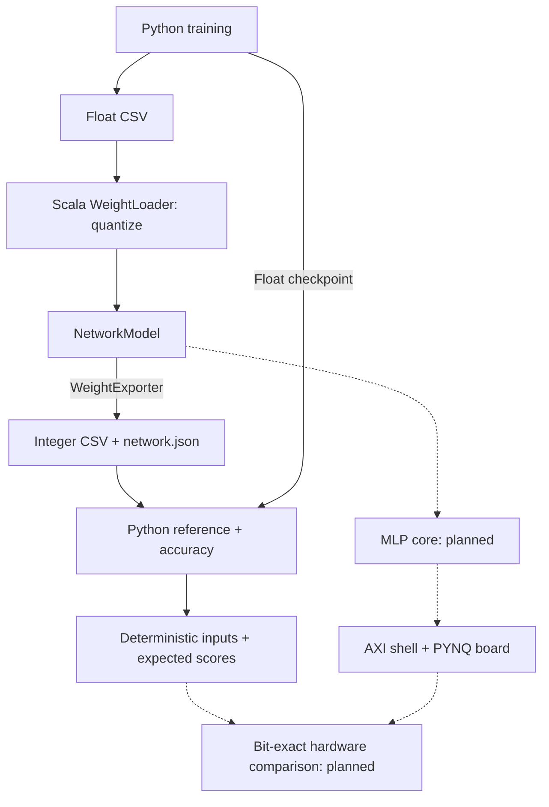

# chisel-cnn-generator
Parameterized Chisel generator for CNN inference accelerators on FPGA. Starts with an MLP; the integer reference is checked bit-exact against PyTorch.

# Architecture



# Python setup
See [python/README.md](python/README.md).


# Commands

```sh
make test
make reference-test WEIGHT_BITS=4 ACTIVATION_BITS=4 BIAS_BITS=32
```

# quantization

Scala owns quantization; Python reads the resulting integers, widths and rules.
Weight, activation and bias widths are configurable. The existing fixed-scale,
ReLU/truncating-shift/bit-extraction policy is preserved. Final scores stay wide
and signed. With the default 8-bit configuration: float 96.61%, integer 96.69%
on 10,000 MNIST images.

Run: [Quantize and evaluate](python/README.md#quantize-and-evaluate).
Contract: [Numerical rules](docs/quantization.md) and [export format](docs/export-format.md).

## Setup

# FPGA flow
See [`hw/README.md`](hw/README.md) for building and running on the PYNQ-Z2, and
[`generator/src/main/scala/shell/README.md`](generator/src/main/scala/shell/README.md) for how the AXI shell is put together.

```
make test      # all Chisel tests
make board     # Chisel -> Vivado bitstream -> PYNQ-Z2 smoke test
```

# File overview

### Repository root
| File | Role |
|---|---|
| `docs` | Holds the illustrations used in READMEs across the repo. |
| `Makefile` | One entry point for test, RTL generation, Vivado build and deploy; picks the right tools on Windows/Linux. |
| `.gitattributes` | Forces LF line endings for Makefile/Tcl/Python so they work on both Windows and Linux. |
| `.gitignore` | Keeps build output (`hw/vivado/`, `target/`, logs, bitstreams) out of git. |
| `.github/workflows/ci.yml` | GitHub Actions: runs `sbt test` on every push and pull request. |
| `LICENSE` | Project license. |

### `python/` — training and reference
| File | Role |
|---|---|
| `train_model.py` | Trains the MNIST MLP in PyTorch and exports weights/biases as CSV. |
| `requirements.txt` | Python packages for training. |
| `ReadME` | How to set up the venv and run the training. |
| `0_weight.csv`, `0_bias.csv`, `2_weight.csv`, `2_bias.csv` | Trained float parameters per layer (`[in][out]` layout), input to the generator. |
| `mlp_weights.pt` | The trained PyTorch model (state dict). |
| `data/MNIST/` | MNIST dataset downloaded by torchvision. |

### `generator/` — Chisel/Scala
| File | Role |
|---|---|
| `build.sbt`, `project/build.properties` | sbt build: Scala 2.13, Chisel 6.7, chiseltest. |
| `src/main/scala/Top.scala` | Early placeholder top + `TopGen`; currently used to try out the weight loader. |
| `src/main/scala/MAC/MacArray.scala` | Dot product: activations × weights summed in an adder tree, plus bias. |
| `src/main/scala/activation/Activation.scala` | ReLU, then right shift to bring the MAC sum back to an 8-bit activation. |
| `src/main/scala/model/NetworkModel.scala` | Data classes for a quantized network (`LayerParams`: weights, bias, shift). |
| `src/main/scala/service/WeightLoader.scala` | Reads the CSVs and quantizes them to int8 weights, wide biases and per-layer shifts. |
| `src/main/scala/shell/` | AXI shell around any core — see the table below and `shell/README.md`. |
| `src/test/scala/PlaceholderTest.scala` | Sanity test of `Top`. |
| `src/test/scala/Unittests/MacArrayTest.scala` | Tests the MAC against a software model, incl. extreme values. |
| `src/test/scala/Unittests/ActivationTest.scala` | Tests ReLU and shift against a software model. |
| `src/test/scala/Unittests/WeightLoaderTest.scala` | Tests loading order, quantization, shifts and bias scaling. |
| `src/test/resources/weights/` | Copy of the CSVs used by `WeightLoaderTest`. |
| `src/test/scala/shell/AccelShellTest.scala` | Bus-model tests of the shell: AXI-Lite registers, byte strobes, streaming with TLAST/backpressure, port names. |

### `generator/src/main/scala/shell/` — the AXI shell
| File | Role |
|---|---|
| `AccelConfig.scala` | `AccelConfig` (sizes, stream width, clock, ID, config hash) and `RegMap` (fixed register offsets) — the single source of truth. |
| `Axi.scala` | AXI-Lite and AXI-Stream port bundles whose names Vivado recognizes, plus `StreamBeat`. |
| `AxiLiteSlave.scala` | AXI-Lite protocol engine: turns bus handshakes into a write pulse and a read address/data pair. |
| `Core.scala` | `CoreIO` (the interface every core implements), the `AccelCore` factory, and the `StreamStub` test core. |
| `AccelShell.scala` | Register file, cycle counter, soft reset and stream wiring (`AccelShellInner`) + AXI clock/reset top (`AccelShell`). |
| `ShellGen.scala` | Generates `AccelShell.sv`, the Verilog wrapper `accel_top.v`, `shell_params.tcl` and `hw_manifest.json`. |
| `README.md` | How the shell files fit together, with diagrams. |

### `hw/` — FPGA build
| File | Role |
|---|---|
| `README.md` | Prerequisites, board setup, how to build and run, register map. |
| `scripts/build.tcl` | Vivado batch script: block design (PS + DMA + accel), synthesis, implementation, timing check, export of `.bit`/`.hwh`. |
| `scripts/deploy.py` | Copies the overlay and driver to the board over SSH and runs the smoke test there. |
| `boards/TUL/pynq-z2/` | PYNQ-Z2 board files (from Xilinx/XilinxBoardStore) so Vivado knows the board's DDR/clock setup. |
| `vivado/` *(generated, git-ignored)* | `rtl/` from ShellGen, Vivado `project/`, `reports/`, and the finished `overlay/`. |

### `pynq/` — runs on the board
| File | Role |
|---|---|
| `accel.py` | Generic driver: loads the overlay, checks ID/hash, register access, one packet through the DMA. |
| `smoke_test.py` | Board test: ID/config, the AXI-Lite adder, and DMA streams through the stub; prints PASS/FAIL. |
