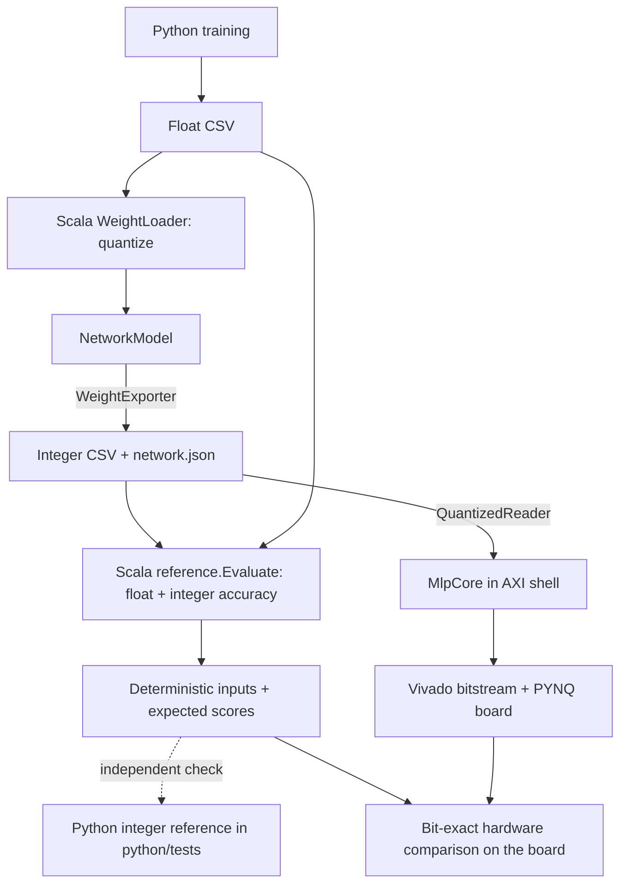
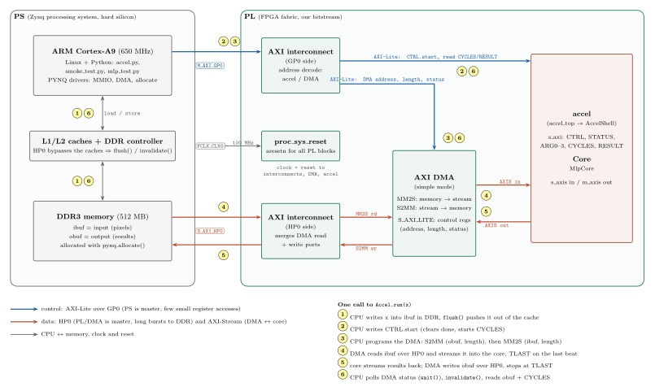
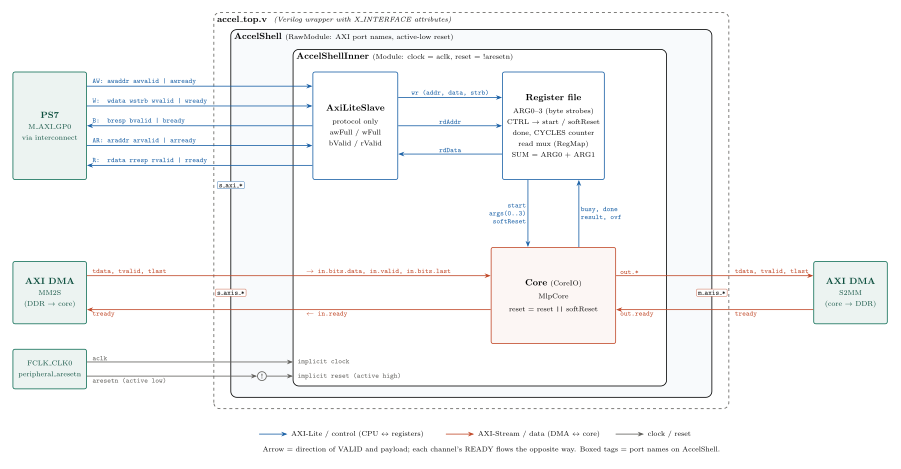
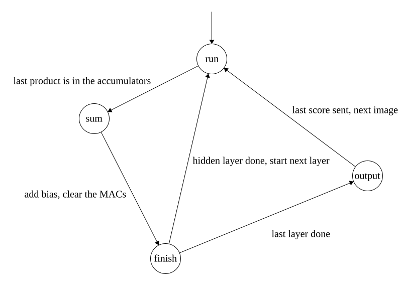

# chisel-cnn-generator
> [!NOTE]
> The long-term goal is a generator for CNN accelerators, hence the name. For now, the repository generates MLP accelerators.

Parameterized Chisel generator for MLP inference accelerators on FPGA; the integer reference is checked bit-exact against PyTorch.

This project is a hardware generator, written in Chisel, that turns a trained neural network into an
accelerator on an FPGA. We train a small MLP (multilayer perceptron) in PyTorch, convert it to integers
in Scala, and generate hardware that runs it on a PYNQ-Z2 board. For now the PYNQ-Z2 is the only
supported board; we plan to support more boards later. The hardware gives exactly the same
scores as our integer reference, bit for bit, and classifies an MNIST digit in 249 clock cycles
(2.49 µs at 100 MHz). The same flow works for MNIST, Fashion-MNIST and KMNIST.

## Getting started

### What you need

- **Simulation and tests:** Java 17, sbt and GNU make. sbt downloads Chisel and the other Scala
  libraries itself. The trained weights and the test sets are in the repository, so nothing has to be
  trained first.
- **Formal proof** (`make formal`): z3 as well, `pip install z3-solver` on Windows and macOS or
  `sudo apt-get install z3` on Linux. The proof takes several minutes, so it is not part of `make test`;
  run it on its own with `make formal`.
- **Python parts** (training, the Python cross-check, PC timing): Python 3.12 or newer with the packages
  in `python/requirements.txt`, see [python/README.md](python/README.md#setup).
- **Hardware:** Vivado and a PYNQ-Z2 on the network. The one-time board setup is in
  [hw/README.md](hw/README.md#prerequisites-checked-2026-10-14). On Windows, install GNU make (for example
  with winget); the commands work from PowerShell and Git Bash.

### Run MNIST on the FPGA, step by step

Run the commands from the repository root. Steps 1 and 2 need Java, sbt and Python, steps 3 and 4
need Vivado, and step 5 needs the board.

0. **Set up Python** (needed for step 1): Python 3.12 or newer. From the repository root:
   ```
   python -m venv venv          # python3 on Linux
   source venv/bin/activate     # PowerShell: .\venv\Scripts\activate  Git Bash: source venv/Scripts/activate
   python -m pip install -r python/requirements.txt
   ```
1. **Train the network** (optional, the trained weights are in the repository): `make train`.
   PyTorch trains the 784-128-10 MLP and writes the float weights to `python/models/csv`.
2. **Quantize and check the accuracy:** `make reference`. Scala turns the weights into integers,
   writes them to `generator/generated/quantized`, prints the float and integer accuracy and writes
   64 test vectors.
3. **Generate the Verilog:** `make rtl CORE=mlp`. It quantizes the network again into
   `hw/vivado/quantized` with the same settings, and Chisel writes the hardware to `hw/vivado/rtl/`.
4. **Build the bitstream:** `make bitstream CORE=mlp`. Vivado writes `hw/vivado/overlay/accel.bit`
   and the reports to `hw/vivado/reports/`, and stops if the design does not meet the clock.
5. **Run it on the board:** `make deploy CORE=mlp`. The bitstream and the test files are copied to the
   board, `mlp_test.py` runs there, and the results come back to `hw/vivado/reports/board_results.json`.

`make board CORE=mlp` runs steps 3 to 5 in one go. Add `DATASET=fashion` or `DATASET=kmnist` to use
another dataset; `make end-to-end DATASET=fashion` runs all five steps plus the PC timing.

### All make commands

Run the commands from the repository root.

| Command | What it does | Output |
|---|---|---|
| `make train` | Trains the MLP with PyTorch | `python/models/csv` |
| `make reference` | Quantizes the weights in Scala, measures float and integer accuracy, writes 64 test vectors | `generator/generated/quantized`, `python/results/quantization_results.csv` |
| `make reference-test` | Runs `make reference`, then checks the test vectors with the independent Python reference | Terminal |
| `make test` | Runs all Chisel tests (not the formal proof) | Terminal |
| `make formal` | Runs the formal proof of `MacPair` (needs z3) | Terminal |
| `make cpu-bench` | Times the float and integer network on the PC | `python/results/cpu_benchmark.json` |
| `make rtl CORE=mlp` | Generates the Verilog | `hw/vivado/rtl/` |
| `make bitstream CORE=mlp` | Runs `make rtl`, then Vivado; stops if timing is not met | `hw/vivado/overlay/accel.bit`, `hw/vivado/reports/` |
| `make deploy CORE=mlp` | Copies the bitstream and test files to the board and runs the test there | `hw/vivado/reports/board_results.json` |
| `make board CORE=mlp` | `make bitstream` + `make deploy` | As `bitstream` and `deploy` |
| `make end-to-end` | `train`, `reference`, `cpu-bench` and `board` for one dataset | All of the above |
| `make report OPEN=1` | Builds the dashboard from the reports and results and opens it | `hw/vivado/reports/dashboard.html` |
| `make compare BUILDS="..."` | Shows several builds side by side | `hw/vivado/compare.html` |
| `make camera` | Runs the webcam demo on the board | Terminal |
| `make clean` | Deletes the build folder | - |
| `make help` | Prints the commands and the current settings | Terminal |

Add `DATASET=fashion` or `DATASET=kmnist` to use another dataset. Without `CORE=mlp`, `rtl`, `bitstream`,
`deploy` and `board` build the `stub` test core.

To reproduce the time per batch size in the Evaluation section, run this loop after `make board CORE=mlp`,
in bash:

```bash
for b in 1 10 100 1000 2000; do
    make deploy CORE=mlp ARGS="--batch $b --images 2000 --latency-images 1 --arm-single 1"
    cp hw/vivado/reports/board_results.json hw/vivado/reports/batch_$b.json
done
```

And in PowerShell:

```powershell
foreach ($b in 1, 10, 100, 1000, 2000) {
    make deploy CORE=mlp ARGS="--batch $b --images 2000 --latency-images 1 --arm-single 1"
    Copy-Item hw\vivado\reports\board_results.json hw\vivado\reports\batch_$b.json
}
```

### Camera demo

`pynq/camera_demo.py` classifies digits held up in front of a USB webcam plugged into the board. It
uses the same MLP bitstream: the ARM turns each camera frame into a 28x28 MNIST-style image and sends
it to the FPGA like any test image.

```bash
make board CORE=mlp   # once: build the MLP into hw/vivado
make camera           # live loop on the board, Ctrl-C stops
```

How each frame is prepared, tips for good results and the board setup are in
[docs/camera-demo.md](docs/camera-demo.md).

## Generator parameters

The hardware is generated from two things: the trained network and a few build settings. Most sizes
are not set by hand but read from the quantized network (`network.json`), so a different network gives
different hardware without any change to the Chisel code.

These are set on the `make` command line, for example `make board CORE=mlp DATASET=fashion`:

| Parameter | Default | What it changes |
|---|---|---|
| `CORE` | `stub` | Which core goes into the shell: `mlp` for the accelerator, or `stub`, a test core that sends its input back, used to test the shell on the board. Always `mlp` for real use |
| `DATASET` | `mnist` | Which dataset is trained and tested on: `mnist`, `fashion` or `kmnist`. All three are 28x28 images with 10 classes |
| `WEIGHT_BITS`, `ACTIVATION_BITS` | 8, 8 | Bit width of weights and activations. The MLP core needs the two to be equal |
| `BIAS_BITS` | 32 | Bit width of the biases |
| `SHIFT_POLICY` | `worst` | How far the sum is shifted after a hidden layer. `worst` never clamps; `typical` keeps more precision but may clamp large sums, which `OVF_COUNT` counts |
| `WEIGHTS` | `python/models/csv` | Which trained float weights and biases to build from |
| `STREAM_W` | 32 | Width of the AXI-Stream in bits: 8, 16 or 32 (only 32 has been run on the board) |
| `FCLK_MHZ` | 100 | Clock frequency of the FPGA part |

The generator works out the rest itself:

| Value | How it is found | MNIST |
|---|---|---|
| Inputs and outputs | First and last layer of the network | 784, 10 |
| Lanes | Neurons in the widest layer | 128 |
| Pixels per stream word | `STREAM_W` / activation bits | 4 |
| Inputs per clock | Up to 4 with `MacPair` (8 bits or less), up to 2 without. Must divide the pixels per word | 4 |
| Accumulator width | 2 x bits + log2 of the largest number of inputs | 26 |
| Rows in each weight memory | Sum over the layers of inputs / inputs per clock, rounded up | 196 + 32 = 228 |

## Architecture and interfaces

### From training to the board

We train the network in Python and do everything after that in Scala and Chisel. The diagram shows the
whole chain. Everything up to the bitstream runs on a PC; the comparison runs on the board.



PyTorch trains a 784-128-10 MLP and saves the weights as float CSV files. Scala turns them into
integers and writes them out together with `network.json`, which says how many bits each layer uses
and how far it shifts. The same Scala code then measures the accuracy on the 10,000 test images and
writes 64 test images with the exact scores the hardware has to produce. `ShellGen` builds the
hardware from the integer weights, and Vivado turns it into a bitstream. Finally `deploy.py` copies
everything to the board, where `mlp_test.py` runs the test images through the FPGA and compares every
score with the same network computed in NumPy on the ARM.

`make end-to-end` runs the whole chain for one dataset.

### The system on the board

The PYNQ-Z2 has a Zynq-7020 chip with two parts. The processing system (PS) has two ARM cores that
run Linux with PYNQ, and it connects to the board's DDR memory. The programmable logic (PL) is the
FPGA, where our accelerator sits next to a Xilinx DMA that moves data between DDR and the accelerator.



The ARM only gives orders. It puts the images in DDR, starts the accelerator and tells the DMA where
the data is (steps 1-3). The DMA then streams the images into the accelerator and writes the scores
back to DDR on its own (steps 4-5), and the ARM reads them when the DMA is done (step 6). Because the
DMA goes past the CPU cache, the driver flushes the cache before a run and invalidates it after. With
batching, one run carries many images, so this overhead is paid once per batch.

The ports, the register map and how to build and run on the board are described in
[hw/README.md](hw/README.md).

### The AXI shell

Our core never talks AXI itself. It sits inside a fixed shell, `AccelShell`, that handles the AXI-Lite
registers and the AXI-Stream ports. That way the block design, the register map and the Python driver
stay the same for every core. We first used the shell with a test core, `stub`, that just sends its
input back, and later put the MLP core into the same shell.



The ARM talks to the shell through a few registers. `CTRL` starts a run, `STATUS` says whether the
core is busy, done or got a packet of the wrong length, `CYCLES` counts clock cycles from the first
input word to the last output word, `RESULT` holds the predicted class, and `ARG0` sets how many images
are in a batch. The full register map is in
[hw/README.md](hw/README.md#register-map-axi-lite-identical-for-every-core), and
[the shell's own README](generator/src/main/scala/shell/README.md) explains how the files fit together.

`ShellGen` writes a small JSON file, `hw_manifest.json`, next to the hardware. It holds the register
offsets and a hash of the configuration, and the weights are part of that hash. The same hash is built
into the hardware as the `CFG_HASH` register. When the driver loads a bitstream, it compares the two,
so a bitstream built from other weights is caught before it is used.

The core has to set TLAST on its last output word, otherwise the DMA never finishes. In the other
direction, the core checks that the input packet has the expected length and sets the error bit in
`STATUS` if it doesn't.

### The MLP core

The MLP core (`generator/src/main/scala/mlp/`) runs the whole network on one column of 128 lanes, one
per neuron in the widest layer. Each lane has its own weight memory and its own multiply-accumulate
unit (MAC). The same lanes are reused for every layer: first they compute the 128 hidden neurons, then
lanes 0-9 compute the 10 outputs.

Each clock, the core takes 4 inputs and gives them to all 128 lanes at once. Every lane reads its 4
matching weights from its own memory, multiplies, adds the 4 products and adds the sum to its
accumulator. So the first layer, with 784 inputs, takes 196 clocks, and the second, with 128 inputs,
takes 32. The first layer reads the pixels straight from the stream, where one 32-bit word carries 4
pixels of 8 bits, so the image is never stored. The second layer reads the hidden activations from
registers.

At the end of the hidden layer every lane adds its bias, applies ReLU, shifts the sum right and clamps
it to 0-255, so the next layer gets 8-bit inputs again. The last layer skips this and sends the raw
scores, and the core picks the largest one as `RESULT`.

Two lanes share one DSP block per input (`MacPair`): the pixel is multiplied by both weights packed into
one number, and the two products come out of the same multiplication. 128 lanes times 4 inputs is 512
products per clock, which this turns into 256 multipliers. The chip only has 220 DSPs, so the last 36
are built from LUTs. `MacPairFormalSpec` proves that a `MacPair` gives the same result as two separate
MACs for all inputs.

| Module | What it does |
|---|---|
| `MlpCore` | State machine and counters, wires the modules together |
| `StreamReader` | Unpacks 4 pixels per clock from the stream and checks the packet length |
| `WeightBanks` | One weight memory (BRAM) per lane, filled with the weights when the hardware is generated |
| `MacArray` (`Mac`, `MacPair`) | 128 lanes that multiply and accumulate 4 inputs per clock |
| `ActivationArray` | ReLU, shift and clamp at the end of a hidden layer |
| `OutputArgmax` | Sends the 10 scores on the stream with TLAST on the last one, and finds the largest |

### The state machine



In `run` the core feeds 4 inputs per clock into the lanes. When the last product has reached the
accumulators, `sum` adds the bias and clears the MACs for the next layer. In `finish`, a hidden layer
goes through ReLU, shift and clamp into the activation registers, and the core starts the next layer.
After the last layer the sums are kept as raw scores, and the core moves to `output`, which sends the
10 scores, one per clock, and then goes back to `run` for the next image in the batch. A start from the
ARM puts the core back in `run` from any state.

Each layer costs one clock per group of 4 inputs, plus 6 clocks: 2 until the last multiplication, 2
until its product is in the accumulator, and one each for `sum` and `finish`. For MNIST, counting the
first input word as clock 0, the last score leaves on clock

(196 + 6) + (32 + 6) + 10 - 1 = 249.

In a batch the next image starts right after, so each image takes about 250 clocks, or 2.5 µs at
100 MHz.

## Hardware usage (MNIST)

MNIST MLP 784-128-10, 8-bit, on the PYNQ-Z2 (xc7z020) at 100 MHz, after routing (WNS +0.297 ns).
128 lanes x 4 inputs per clock = 512 multiply-accumulates per clock, 249 cycles per image.

| Block | LUT | FF | BRAM | DSP | Used for |
|---|---|---|---|---|---|
| MAC array (64 MacPairs) | 12,390 | 8,324 | - | 220 | Multiply, sum of 4 products, sign correction, accumulate |
| Weight banks (128) | 6,994 | 0 | 128 x RAMB18 | - | One bank per lane |
| MLP control | 2,939 | 3,977 | - | - | FSM, unpacker, activations/logits, ReLU/shift, argmax, packet check |
| AXI-Lite registers | 159 | 82 | - | - | Register map |
| Platform (DMA, interconnect) | 2,861 | 3,831 | 2 x RAMB36 | - | Same in every build |
| **Total** | **25,343 (47.6 %)** | **16,214 (15.2 %)** | **66 / 140** | **220 / 220** | |

The DSPs are the limit: all 220 are used, and the remaining 36 multipliers are built from LUTs. In the
utilization report those 36 MacPairs show 32 extra FFs: the product register that would otherwise sit
inside the DSP. The weight banks show about 7k LUTs although they are plain BRAM; these are most likely
the 36 LUT multipliers, which Vivado places next to the bank outputs they read from. The number of BRAMs is set by
read ports, not by size: each lane reads 4 weights per clock from its own bank, and each bank is only
40 % full (228 x 32 bit). The whole network is about 813 Kbit.

### Other configurations

The generator picks K (inputs per clock) so that a group of K pixels never spans two stream words, so
the bit width and the stream width change K, the number of multipliers and the clocks per image. Those
follow from the configuration; LUT, FF, BRAM, DSP and timing are from the Vivado builds.

| Build | Bits | Stream | Pixels / word | K | Multipliers | Cycles / image | LUT | FF | BRAM tiles | DSP | WNS |
|---|---|---|---|---|---|---|---|---|---|---|---|
| Default (above) | 8 | 32 bit | 4 | 4 | 256 | 249 | 25,343 (47.6 %) | 16,214 | 66 | 220 | +0.297 ns |
| 4-bit | 4 | 32 bit | 8 | 4 | 256 | 249 | 25,003 (47.0 %) | 16,806 | 9 | 0 | +0.199 ns |
| 16-bit stream | 8 | 16 bit | 2 | 2 | 128 | 477 | 16,159 (30.4 %) | 15,097 | 66 | 128 | +0.114 ns |

With a 16-bit stream only 2 pixels arrive per word, so K = 2: half the multipliers, all 128 in DSPs and
none in LUTs, for (392 + 6) + (64 + 6) + 10 - 1 = 477 clocks per image, about twice as many. It also
needs 9,200 fewer LUTs: there are no LUT multipliers, and each lane adds 2 products per clock instead of 4.

With 4 bits the multipliers are only 4 x 12 bit, and Vivado builds all 256 of them from LUTs (7,140 LUTs
for the MAC array, no DSPs). The weight banks are 228 x 16 bit, and Vivado makes most of them LUT ROM
instead of BRAM: only 14 RAMB18 are left, so BRAM drops from 66 to 9 tiles while the LUT count stays about
the same. The speed is unchanged (K = 4, 249 cycles), but the accuracy drops from 96.69 % to 90.53 %
(integer reference, MNIST).


## Quantization

Python trains in floating point, but the hardware only works with integers. Scala converts the network
and owns all the rules, so the hardware, the Scala reference and the board test use exactly the same
numbers. With the default 8 bits:

- Pixels from 0 to 1 become integers from 0 to 255.
- Weights between -1 and 1 are multiplied by 128 and rounded, so they become signed 8-bit numbers.
- Biases get the same scale as the sum they are added to and are stored with 32 bits.
- After a hidden layer the sum is shifted right so it fits in 8 bits again. With `SHIFT_POLICY=worst`
  the shift is chosen so that even the largest possible sum fits, so nothing is ever clamped. For MNIST
  that is a shift of 13 after the first layer.
- The last layer keeps the full sum as the score.

Accuracy on the 10,000 test images, 8-bit, `SHIFT_POLICY=worst`:

| Dataset | Float | Integer |
|---|---|---|
| MNIST | 96.61 % | 96.69 % |
| Fashion-MNIST | 86.10 % | 86.07 % |
| KMNIST | 86.01 % | 86.00 % |

The integer network loses at most 0.03 percentage points, and on MNIST it is even slightly better. The
exact rules are in [docs/quantization.md](docs/quantization.md) and the file format in
[docs/export-format.md](docs/export-format.md).

## Evaluation

### Does it compute the right thing?

The hardware has to give exactly the same scores as the integer reference, bit for bit, not just the
same predicted class. We check that at four levels:

- **Unit tests** (`make test`, chiseltest) for each building block: `Mac`, `MacPair`, `MacArray`,
  `Activation`, the weight loader and exporter, and the integer reference. `MlpCoreTest` runs a
  hand-checked network and random networks with random bit widths (4, 6 and 8), shift policies and
  stream widths, with and without backpressure, plus batches and a packet that is too short.
  `AccelShellTest` drives the shell through a bus model with random delays on every handshake.
- **The whole shell:** `MlpShellTest` sends the test vectors through the AXI shell with the MLP core and
  compares every score with the reference.
- **Formal proof:** `MacPairFormalSpec` (`make formal`) uses the z3 solver to prove that a `MacPair`
  gives the same result as two separate MACs for all inputs, not just random ones.
- **On the board:** `mlp_test.py` checks the 64 test vectors and then all 10,000 test images against the
  same network in NumPy on the ARM.

CI runs the Chisel tests, the formal proof, and the Scala export with the independent Python check at
four bit widths (4/4, 8/8, 12/12, and 4-bit weights with 8-bit activations) on every push.

Results on the board:

| Dataset | Test vectors bit-exact | Test images bit-exact | Accuracy on the FPGA |
|---|---|---|---|
| MNIST | 64 / 64 | 10,000 / 10,000 | 96.69 % |
| Fashion-MNIST | 64 / 64 | 10,000 / 10,000 | 86.07 % |
| KMNIST | 64 / 64 | 10,000 / 10,000 | 86.00 % |

Because every score is bit-exact, the FPGA has exactly the accuracy of the integer reference in the
quantization section.

### Speed

The core needs 249 clock cycles for one image, which is 2.49 µs at 100 MHz. Timing is met at 100 MHz
with 0.297 ns to spare, so the design could run at roughly 103 MHz.

What the ARM sees is slower, because every run also goes through Python, the driver and the DMA. The
table shows the time per image measured on the ARM for 2,000 MNIST images, with different numbers of
images per DMA transfer:

| Images per transfer | Time per image | Total for 2,000 images | Bit-exact |
|---|---|---|---|
| 1 | 2.17 ms | 4.34 s | 2000/2000 |
| 10 | 0.228 ms | 0.456 s | 2000/2000 |
| 100 | 0.033 ms | 0.065 s | 2000/2000 |
| 1000 | 0.014 ms | 0.028 s | 2000/2000 |
| 2000 | 0.015 ms | 0.030 s | 2000/2000 |

With one image per transfer almost all of the 2.17 ms is overhead. With 1,000 images per transfer the
overhead is shared, and an image takes 0.014 ms. For comparison, the same integer network in NumPy takes
0.141 ms per image on a desktop PC, so the board is about 10 times faster with large batches.

### Measurement conditions

- Board: PYNQ-Z2 with a Zynq-7020 (xc7z020clg400-1), PYNQ 3.1.1 image, ARM Cortex-A9 at 650 MHz.
- FPGA clock: 100 MHz. Resource numbers are from Vivado after routing.
- PC numbers: a desktop PC with an Intel CPU (20 cores) and Python 3.12.

### The biggest remaining uncertainty

We have only built one network size for the board, 784-128-10. The generator takes any network, and
the simulations run random networks, but we have not built a larger network on the FPGA. How the
hardware usage grows with the size of the network, and how large a network fits on the Zynq-7020, is
therefore the biggest open question.

## Limitations

- The MLP core needs the same bit width for weights and activations.
- Each neuron in the widest layer gets its own lane, and the core cannot yet reuse one lane for several
  neurons. A network with a much wider layer therefore needs more hardware than the FPGA has.
- The `DATASET` parameter supports MNIST, Fashion-MNIST and KMNIST. Any other dataset needs its own
  entry in the Makefile and in the training script.
- With one image per DMA transfer, Python and the DMA take almost all the time: 2.17 ms per image,
  while the core itself needs 2.49 µs.

## Use of generative AI

Generative AI tools were used as writing and revision support during the preparation of the documentation,
primarily for drafting, language polishing, structural feedback, and identifying inconsistencies
between the documentation and the implementation as the project progressed. LLMs were also used for
simpler parts of the work: figures, the HTML dashboard (`hw/scripts/report.py`), scripting (the
Makefile, the Vivado Tcl script and the Python scripts for the board), refactoring and boilerplate.

The authors remain responsible for all technical claims, source code, experimental results, and final
wording. All claims about the system architecture, implementation, and evaluation were checked against
the project source code and test results before submission.

## File overview

<details>
<summary>Show the file tree</summary>

```
chisel-cnn-generator/
├── .github/workflows/
│   └── ci.yml                          # sbt test, the formal proof and the integer reference at four bit widths
├── docs/
│   ├── figures/                        # Shell wiring and PYNQ dataflow (.tex/.svg/.pdf)
│   ├── camera-demo.md                  # Webcam demo on the board
│   ├── export-format.md                # File format of the integer export and the test vectors
│   └── quantization.md                 # Numerical rules
├── generator/                          # Chisel/Scala: quantization, cores, AXI shell, RTL generation
│   ├── src/main/scala/
│   │   ├── activation/                 # ReLU, shift and clamp
│   │   │   ├── Activation.scala
│   │   │   └── ActivationArray.scala
│   │   ├── MAC/                        # Multiply-accumulate
│   │   │   ├── Mac.scala               # Mac and MacPair (two lanes per DSP)
│   │   │   └── MacArray.scala
│   │   ├── mlp/                        # The MLP core
│   │   │   ├── MlpCore.scala           # State machine and wiring
│   │   │   ├── StreamReader.scala
│   │   │   ├── WeightBanks.scala
│   │   │   └── OutputArgmax.scala
│   │   ├── model/                      # Data classes for a quantized network
│   │   ├── reference/                  # Float and integer reference, accuracy, test vectors (make reference)
│   │   ├── service/                    # Quantizes the float CSVs, writes and reads the integer export
│   │   └── shell/                      # AXI shell around any core (see its README)
│   ├── src/test/scala/
│   │   ├── formal/MacPairFormalSpec.scala
│   │   ├── shell/                      # AccelShellTest, MlpShellTest
│   │   └── Unittests/                  # Mac, MacArray, Activation, MlpCore, weight loader/exporter, reference
│   ├── generated/                      # Committed integer exports + test vectors (MNIST, fashion/, kmnist/)
│   └── build.sbt                       # Scala 2.13, Chisel 6.7
├── hw/                                 # FPGA build and board tooling (see hw/README.md)
│   ├── boards/TUL/pynq-z2/             # PYNQ-Z2 board files for Vivado
│   ├── scripts/
│   │   ├── build.tcl                   # Vivado: block design, synthesis, implementation, bitstream
│   │   ├── deploy.py                   # Copies to the board over SSH, runs a script, fetches results
│   │   └── report.py                   # Vivado reports + results -> HTML dashboard
│   └── vivado/                         # Build output (git-ignored)
├── pynq/                               # Runs on the board
│   ├── accel.py                        # Driver: overlay, registers, DMA
│   ├── camera_demo.py                  # Webcam demo (make camera)
│   ├── mlp_test.py                     # MLP: bit-exactness, accuracy, timing
│   └── smoke_test.py                   # Test of the stub core
├── python/                             # Training, the independent integer check, PC timing (see python/README.md)
│   ├── data/                           # MNIST, FashionMNIST, KMNIST
│   ├── models/                         # Trained models and float CSVs (fashion/, kmnist/ for the others)
│   ├── results/                        # Accuracy and PC timing (fashion/, kmnist/ for the others)
│   ├── scripts/                        # train_model.py, benchmark_cpu.py, integer_reference.py
│   ├── tests/test_quantization.py      # Independent check of the Scala vectors (make reference-test)
│   └── requirements.txt
├── Makefile                            # One entry point for everything above
└── README.md
```

</details>
