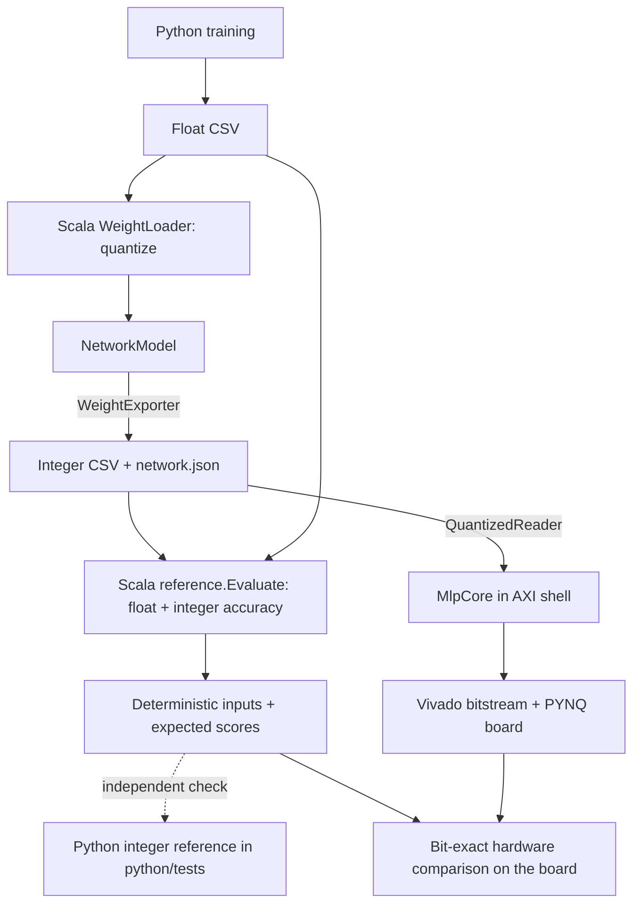

# chisel-cnn-generator
> [!DISCLAIMER]
> The project has pivot to optimizing MLP accelerator for the time beeing
Parameterized Chisel generator for MLP inference accelerators on FPGA; the integer reference is checked bit-exact against PyTorch.

# Architecture



# Python setup
See [python/README.md](python/README.md).


# Commands

```sh
make test
make reference-test WEIGHT_BITS=4 ACTIVATION_BITS=4 BIAS_BITS=32
```

# quantization

Python trains; Scala owns quantization, the integer reference, accuracy and the test vectors.
Weight, activation and bias widths are configurable. The existing fixed-scale,
ReLU/truncating-shift/bit-extraction policy is preserved. Final scores stay wide
and signed. With the default 8-bit configuration: float 96.61%, integer 96.69%
on 10,000 MNIST images.

Run: [Quantize and evaluate](python/README.md#quantize-and-evaluate).
Contract: [Numerical rules](docs/quantization.md) and [export format](docs/export-format.md).

## Setup

# FPGA flow
See [`hw/README.md`](hw/README.md) for building and running on the PYNQ-Z2, and
[`generator/src/main/scala/shell/README.md`](generator/src/main/scala/shell/README.md) for how the AXI shell is put together.

```
make test             # all Chisel tests
make board            # Chisel -> Vivado bitstream -> PYNQ-Z2 smoke test (stub core)
make board CORE=mlp   # the MLP: bit-exactness, accuracy and speed on the board
make report OPEN=1    # dashboard: timing, resources, Python vs hardware
```

# Camera demo: live digits from a USB webcam

`pynq/camera_demo.py` classifies digits held up in front of a USB webcam plugged into the board.
The hardware is the same MLP bitstream: the camera sits on the ARM side, which turns each frame into
an MNIST-style 28x28 image and sends it to the FPGA like any test image.

```bash
make board CORE=mlp   # once: build the MLP into hw/vivado (make camera uses that build)
make camera           # live loop on the board: ASCII preview + the FPGA's answer, Ctrl-C stops
```

**Pipeline per frame (on the ARM):**

```
camera frame 640x480 -> grayscale -> centre square (60 % of the height) -> blur
  -> polarity: dark ink on paper is inverted, chalk on a blackboard is kept (median brightness decides)
  -> background removal (70th percentile -> 0) -> tight box around the stroke -> stroke thickening
  -> longest side to 20 px -> pasted into 28x28 -> centre of mass to (14, 14)
  -> quantize_pixels -> pack (4 pixels/word) -> FPGA -> 10 scores -> argmax
```

These are the same steps MNIST itself was made with (digit fits 20x20, centred by mass), so the
network sees images that look like its training data. Raw 720p cannot be the input: 921,600 inputs
would need ~118 M weights in the first layer, far beyond the board's ~0.6 MB of BRAM.

**Output:** the 28x28 image as ASCII art, the predicted digit, the *margin* (best score minus second
best, a rough confidence measure in the network's integer units) and CYCLES / wall time per image.
The ASCII preview is the first thing to check when an answer is wrong: if it does not look like an
MNIST digit, the network has no chance.

**Getting good results:**
- Hold the digit inside the centre of the picture and let it fill most of that square.
- Paper: a thick dark marker on white paper. Blackboard: a clean (wet-wiped) board, pressed chalk,
  and an angle without glare from the ceiling lights.
- Accuracy is lower than the 96.69 % on MNIST, because camera digits differ from the training set
  (lighting, stroke width, angle). Retraining with augmentation would help and needs no hardware change.

**Board setup:** the camera must be a standard UVC webcam (`lsusb`, `ls /dev/video*` on the board),
OpenCV must be importable in the PYNQ venv (`python3 -c "import cv2"`), and the board should run on
the 12 V supply (jumper on REG), since a camera on the USB host port can brown out a USB-powered board.

The FPGA round trip takes ~2 ms per frame including Python; the camera and the preprocessing on the ARM
are the bottleneck.

# Evaluation: Python vs hardware

```bash
make cpu-bench                   # PyTorch float + NumPy integer on this PC -> python/results/cpu_benchmark.json
make board CORE=mlp              # FPGA + the same integer network on the board's ARM -> reports/board_results.json
make report OPEN=1               # one page: timing, resources, accuracy and time per image side by side
make compare BUILDS="hw/vivado/mlp-worst hw/vivado/mlp-typical"   # configurations next to each other
```

`make board CORE=mlp` runs `make reference` first and builds the hardware from that export
(`generator/generated/quantized/`), so the bitstream, the test vectors and the board test always come
from the same quantized network. One command goes from float CSVs to inference on the board:
`make board CORE=mlp WEIGHTS=path/to/csv WEIGHT_BITS=8 ACTIVATION_BITS=8`.

## Choosing batchsize
```powershell
foreach ($b in 1, 10, 100, 1000, 2000) {
    make deploy CORE=mlp ARGS="--batch $b --images 2000 --latency-images 1 --arm-single 1"
    Copy-Item hw\vivado\reports\board_results.json hw\vivado\reports\batch_$b.json
}
```
For MNIST MLP, 2000 images, packed 4 pixels/word, 249-cycle core
| Batch | Time / image | Total (2,000 images) | Bit-exact |
|---|---|---|---|
| 1     | 2.17 ms   | 4.34 s  | 2000/2000 |
| 10    | 0.228 ms  | 0.456 s | 2000/2000 |
| 100   | 0.033 ms  | 0.065 s | 2000/2000 |
| 1000  | 0.014 ms  | 0.028 s | 2000/2000 |
| 2000  | 0.015 ms  | 0.030 s | 2000/2000 |


## Resource usage
MNIST MLP 784-128-10, 8-bit, PYNQ-Z2 (xc7z020) at 100 MHz, routed (WNS +0.297 ns). 128 lanes x 4 inputs
per clock = 512 multiply-accumulates per clock, 249 cycles per image.

| Block | LUT | FF | BRAM | DSP | Used for |
|---|---|---|---|---|---|
| MAC array (64 MacPairs) | 12,390 | 8,324 | - | 220 | Multiply, sum of 4 products, sign correction, accumulate |
| Weight banks (128) | 6,994 | 0 | 128 x RAMB18 | - | One bank per lane; LUTs see below |
| MLP control | 2,939 | 3,977 | - | - | FSM, unpacker, activations/logits, ReLU/shift, argmax, packet check |
| AXI-Lite registers | 159 | 82 | - | - | Register map |
| Platform (DMA, interconnect) | 2,861 | 3,831 | 2 x RAMB36 | - | Same in every build |
| **Total** | **25,343 (47.6 %)** | **16,214 (15.2 %)** | **66 / 140** | **220 / 220** | |

- **DSP:** two lanes share one DSP48 per input (`a * (w1 * 2^16 + w0)`), so 512 products need 256 DSPs.
  The chip has 220, so 36 packed multipliers are built in fabric. Those 36 MacPairs show 32 extra FFs
  (the product register outside the DSP).
- **Weight banks:** the bank RTL is a plain BRAM. The ~7k LUTs reported under the banks are most likely
  the 36 fabric multipliers, which Vivado places next to their operand, the bank output register.
- **BRAM:** the count is set by read ports, not capacity: each lane reads 4 weights per clock from its own
  bank (228 x 32 bit, 40 % full). The whole network is ~813 Kbit.
- **Efficiency:** 44 accelerator LUTs and 0.43 DSP per MAC/clock, compared with 67 LUTs and 1 DSP for the
  previous 1-input-per-clock core (929 cycles).

# File overview

```
chisel-cnn-generator/
├── .github/workflows/
│   └── ci.yml                          # sbt test on every push and pull request
├── docs/                               # Numerical contract, export format and figures
│   ├── figures/                        # Shell wiring and PYNQ dataflow (.tex/.svg/.pdf)
│   ├── export-format.md
│   └── quantization.md
├── generator/                          # Chisel/Scala: quantization, cores, AXI shell, RTL generation
│   ├── project/
│   │   └── build.properties            # Specifies the sbt version
│   ├── src/
│   │   ├── main/scala/
│   │   │   ├── activation/             # ReLU + shift back to the activation width
│   │   │   │   └── Activation.scala
│   │   │   ├── MAC/                    # Multiply-accumulate building blocks
│   │   │   │   ├── Mac.scala
│   │   │   │   └── MacArray.scala
│   │   │   ├── mlp/                    # The folded MLP core
│   │   │   │   └── MlpCore.scala
│   │   │   ├── model/                  # Data classes for a quantized network
│   │   │   │   ├── NetworkModel.scala
│   │   │   │   └── QuantizationConfig.scala
│   │   │   ├── reference/              # Bit-exact reference: accuracy + test vectors (make reference)
│   │   │   │   ├── Evaluate.scala      # Entry point: float/integer accuracy, writes the test vectors
│   │   │   │   ├── FloatReference.scala
│   │   │   │   ├── IntegerReference.scala
│   │   │   │   └── Mnist.scala
│   │   │   ├── service/                # Quantizes the float CSVs, writes and reads the integer export
│   │   │   │   ├── Csv.scala
│   │   │   │   ├── QuantizedReader.scala # Export -> NetworkModel, for the hardware and the reference
│   │   │   │   ├── WeightExporter.scala
│   │   │   │   └── WeightLoader.scala
│   │   │   ├── shell/                  # AXI shell around any core (see its README)
│   │   │   │   ├── AccelConfig.scala   # Sizes, stream width, register map: single source of truth
│   │   │   │   ├── AccelShell.scala
│   │   │   │   ├── Axi.scala
│   │   │   │   ├── AxiLiteSlave.scala
│   │   │   │   ├── Core.scala
│   │   │   │   ├── ShellGen.scala      # Entry point: reads the export, writes the RTL and manifest for Vivado
│   │   │   │   └── README.md
│   │   └── test/
│   │       ├── resources/weights/      # CSV copies used by the tests
│   │       └── scala/                  # Tests against software models
│   │           ├── shell/
│   │           │   └── AccelShellTest.scala
│   │           ├── Unittests/
│   │           │   ├── ActivationTest.scala
│   │           │   ├── IntegerReferenceTest.scala
│   │           │   ├── MacArrayTest.scala
│   │           │   ├── MacTest.scala
│   │           │   ├── MlpCoreTest.scala
│   │           │   ├── WeightExporterTest.scala
│   │           │   └── WeightLoaderTest.scala
│   ├── generated/quantized/            # Integer export + test vectors from make reference; ShellGen builds from it
│   └── build.sbt                       # Scala 2.13, Chisel 6.7
├── hw/                                 # FPGA build and board tooling (see hw/README.md)
│   ├── boards/TUL/pynq-z2/             # PYNQ-Z2 board files for Vivado
│   ├── scripts/
│   │   ├── build.tcl                   # Vivado: block design, synthesis, implementation, bitstream
│   │   ├── deploy.py                   # Copies to the board over SSH, runs a script, fetches results
│   │   └── report.py                   # Vivado reports + results -> HTML dashboard
│   └── vivado/                         # Build output (git-ignored)
├── pynq/                               # Runs on the board
│   ├── accel.py                        # Generic driver: overlay, registers, DMA
│   ├── camera_demo.py                  # Live webcam digits (make camera)
│   ├── mlp_test.py                     # MLP: bit-exactness, accuracy, timing, --demo
│   └── smoke_test.py                   # Stub core test
├── python/                             # Training, an independent integer check and PC benchmarks (see python/README.md)
│   ├── data/MNIST/                     # Downloaded by torchvision
│   ├── models/                         # Trained model and float CSVs (input to the generator)
│   ├── results/                        # PC benchmark and quantization results
│   ├── scripts/
│   │   ├── benchmark_cpu.py
│   │   ├── integer_reference.py        # Recomputes the Scala vectors in python/tests
│   │   └── train_model.py
│   ├── tests/
│   │   └── test_quantization.py        # Independent check of the Scala vectors (make reference-test)
│   ├── README.md
│   └── requirements.txt
├── .gitattributes                      # LF line endings for Makefile/Tcl/Python
├── .gitignore
├── LICENSE
├── Makefile                            # One entry point: test, reference, rtl, bitstream, deploy, camera, report
└── README.md
```
