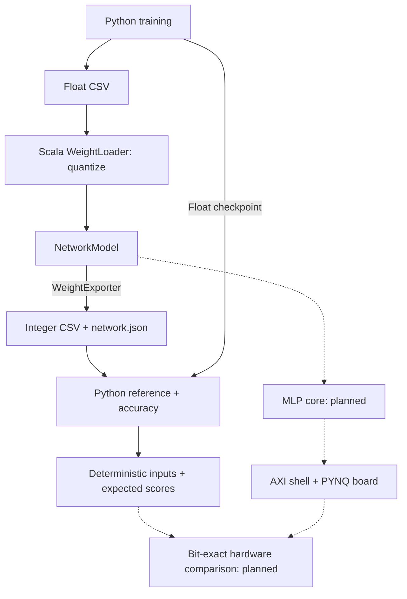

# chisel-cnn-generator
Parameterized Chisel generator for CNN inference accelerators on FPGA. Starts with an MLP; the integer reference is checked bit-exact against PyTorch.

# Architecture



# Python setup
See [python/README.md](python/README.md).


# Commands

```sh
make test
make reference-test WEIGHT_BITS=4 ACTIVATION_BITS=4 BIAS_BITS=32
```

# quantization

Scala owns quantization; Python reads the resulting integers, widths and rules.
Weight, activation and bias widths are configurable. The existing fixed-scale,
ReLU/truncating-shift/bit-extraction policy is preserved. Final scores stay wide
and signed. With the default 8-bit configuration: float 96.61%, integer 96.69%
on 10,000 MNIST images.

Run: [Quantize and evaluate](python/README.md#quantize-and-evaluate).
Contract: [Numerical rules](docs/quantization.md) and [export format](docs/export-format.md).

Full Chisel/board comparisons require the future `MlpCore`; the separate AXI
shell and board workflow are tracked in #38.
