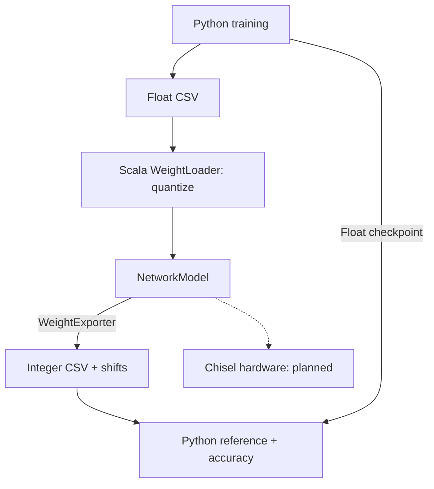

# chisel-cnn-generator
Parameterized Chisel generator for CNN inference accelerators on FPGA. Starts with an MLP; the integer reference is checked bit-exact against PyTorch.

# Architecture

# Python setup
See [python/README.md](python/README.md).

# quantization

int8 weights, uint8 hidden activations, wide signed final scores.
Scala uses fixed scales and worst-case bounds to calculate layer shifts.
Float 96.61%, quantized 96.69% on 10,000 MNIST images.

Run: [Quantize and evaluate](python/README.md#quantize-and-evaluate).
Rules: [Quantization rules](python/README.md#quantization-rules).
