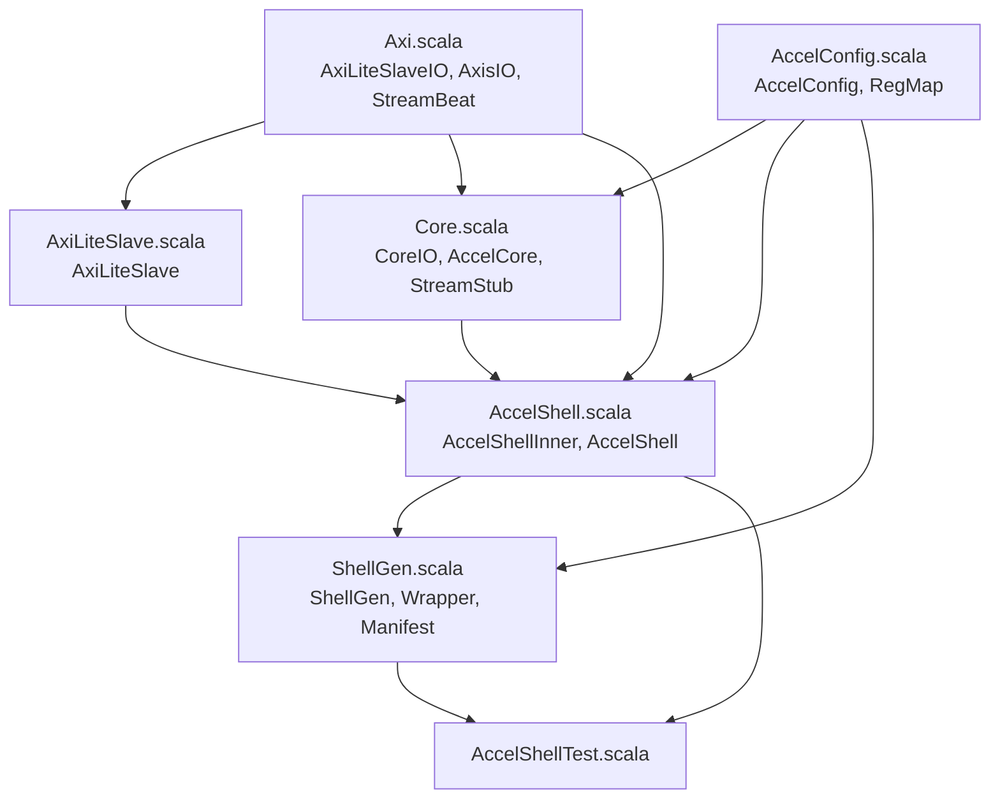
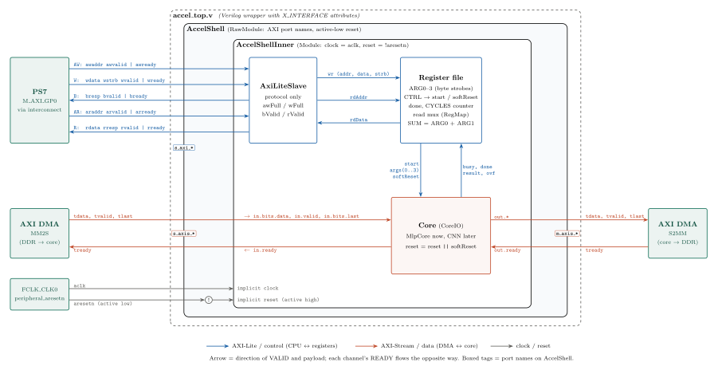
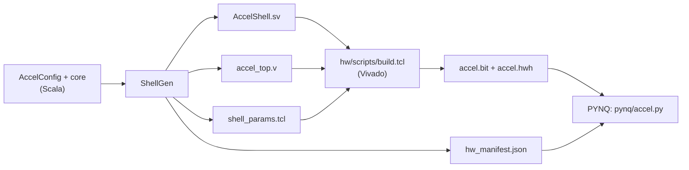

# `shell/` — the AXI shell around the accelerator core

This package wraps **any** accelerator core in a fixed hardware "shell" so the same
Vivado block design, register map and Python driver work for every design — from the
smoke-test `StreamStub` to the MVP `MlpCore`. Only the core changes; nothing around it does.

```
make test      # chiseltest of the shell (AccelShellTest)
make rtl       # ShellGen -> hw/vivado/rtl/
make board     # rtl -> Vivado -> PYNQ smoke test
```

See [`hw/README.md`](../../../../../hw/README.md) for the FPGA flow and the register table.

---

## 1. The files and their roles

| File | Contains | Role in the whole |
|---|---|---|
| `AccelConfig.scala` | `AccelConfig`, `RegMap` | **Single source of truth.** Sizes, stream width, clock, ID and config hash; the fixed register offsets. Every other file reads its numbers from here. |
| `Axi.scala` | `AxiLiteSlaveIO`, `AxisIO`, `StreamBeat` | **Port definitions.** AXI-Lite and AXI-Stream bundles whose field names give Vivado-friendly port names (`s_axi_awaddr`, `m_axis_tlast`, ...). |
| `AxiLiteSlave.scala` | `RegWrite`, `AxiLiteSlave` | **Bus protocol only.** Turns AXI-Lite handshakes into a one-cycle write pulse and a read address/data pair. Knows nothing about what the registers mean. |
| `Core.scala` | `CoreIO`, `AccelCore`, `StreamStub` | **The contract with the core.** `CoreIO` is the only interface a core sees. `AccelCore(cfg)` picks the core by name. `StreamStub` is the test core. |
| `AccelShell.scala` | `AccelShellInner`, `AccelShell` | **The shell itself.** Register file, cycle counter, soft reset, AXIS ↔ Decoupled wiring (inner); AXI clock/reset naming (outer). |
| `ShellGen.scala` | `ShellGen`, `Wrapper`, `Manifest` | **Generator / exporter.** Elaborates `AccelShell` to SystemVerilog and writes the Verilog wrapper, the Tcl params and the JSON manifest for the rest of the flow. |
| `../../test/scala/shell/AccelShellTest.scala` | `AxiDriver`, `AccelShellTest` | **Verification.** Bus-functional model with random delays on every handshake; tests registers, byte strobes, streaming with TLAST/backpressure and top-level port names. |

---

## 2. Who uses whom (compile-time dependencies)



Read it bottom-up as "is built from": `AccelShell` is built from the slave, the core and the
port bundles; `ShellGen` and the tests only ever touch `AccelShell` (+ the config).

---

## 3. How the modules nest (the wrapping)

```
┌─ accel_top.v ───────────────── generated by ShellGen.Wrapper ──────────────────┐
│  Plain Verilog so Vivado accepts it as a block-design module reference.        │
│  X_INTERFACE attributes: aclk is the clock of s_axi/s_axis/m_axis,             │
│  aresetn is their (active-low) reset.                                          │
│  ┌─ AccelShell (RawModule) ──────────────────────────── AccelShell.scala ────┐ │
│  │  Ports: aclk, aresetn, s_axi_*, s_axis_*, m_axis_*  (no io_ prefix)       │ │
│  │  withClockAndReset(aclk, !aresetn)                                        │ │
│  │  ┌─ AccelShellInner (Module) ─────────────────────────────────────────┐   │ │
│  │  │  Normal Module -> testable with chiseltest                         │   │ │
│  │  │  ┌──────────────┐   ┌────────────────┐   ┌─────────────────────┐   │   │ │
│  │  │  │ AxiLiteSlave │──▶│ register file  │──▶│ core: AccelCore     │   │   │ │
│  │  │  │ (protocol)   │◀──│ RegMap, CYCLES │◀──│ (StreamStub/MlpCore)│   │   │ │
│  │  │  └──────────────┘   └────────────────┘   └─────────────────────┘   │   │ │
│  │  └────────────────────────────────────────────────────────────────────┘   │ │
│  └───────────────────────────────────────────────────────────────────────────┘ │
└────────────────────────────────────────────────────────────────────────────────┘
```

**What `X_INTERFACE` does.** Vivado's IP integrator groups loose ports into interfaces by name
(`s_axi_*` becomes one AXI-Lite slave pin, `s_axis_*` / `m_axis_*` AXI-Stream pins). The attributes in
`accel_top.v` add what names alone cannot say: `X_INTERFACE_INFO` marks `aclk` as a *clock* and `aresetn`
as a *reset*; `X_INTERFACE_PARAMETER` says `ASSOCIATED_BUSIF s_axi:s_axis:m_axis` (these buses run on
this clock), `ASSOCIATED_RESET aresetn`, and `POLARITY ACTIVE_LOW`. With that, connection automation wires
the right clock/reset and `validate_bd_design` can check clock domains instead of warning or guessing.

Each layer exists for exactly one reason:

| Layer | Why it exists |
|---|---|
| `accel_top.v` | Vivado can't use a SystemVerilog file as a module-reference top; carries the interface attributes. |
| `AccelShell` | AXI naming and the active-low reset (Chisel resets are active high). |
| `AccelShellInner` | All shell logic, as a normal `Module` so the tests can drive it. |
| core | The actual computation. Sees only `CoreIO`, never AXI. |

---

## 4. How the modules talk at runtime (signals inside `AccelShellInner`)



*Blue: AXI-Lite / control. Red: AXI-Stream / data. Gray: clock and reset. Each arrow points in the
direction of VALID and the payload; the channel's READY flows the other way. Source:
[`docs/figures/accel_shell_wiring.tex`](../../../../../docs/figures/accel_shell_wiring.tex)
(rebuild with `pdflatex` + `pdftocairo -svg`).*

**Control path.**
1. `AxiLiteSlave` completes an AXI write (AW + W in any order) and emits `wr` for one cycle.
2. The register file in `AccelShellInner` decodes `wr.addr` with `RegMap`:
   `ARG0..3` are stored (respecting `wstrb`), a write to `CTRL` produces the `start` pulse
   (bit 0) or a registered soft-reset pulse (bit 1) that resets only the core.
3. For reads, `AxiLiteSlave` exposes `rdAddr`; the register file answers combinationally
   through a `MuxLookup`, and the slave captures `rdData` at the AR handshake.
4. The core reports back `busy`, `done` (pulse), `result`, `ovf`. The shell turns `done`
   into the sticky `STATUS.done` bit and stops the `CYCLES` counter started by `start`.

**Data path.** No logic, only renaming: AXI-Stream (`tvalid/tready/tdata`) and Chisel's
`Decoupled` (`valid/ready/bits`) are the same handshake, and `tlast` travels as `bits.last`.

---

## 5. How the shell reaches the board (generated artifacts)



| Artifact | Consumer | What it carries |
|---|---|---|
| `AccelShell.sv` | Vivado | The hardware (shell + core). |
| `accel_top.v` | Vivado block design | Verilog top + interface/clock/reset attributes. |
| `shell_params.tcl` | `build.tcl` | `STREAM_W`, `ADDR_W`, `FCLK_MHZ`, `CORE` → DMA width, PL clock. |
| `hw_manifest.json` | `pynq/accel.py` | Register offsets, `n_in`/`n_out`, stream width, `id`, `cfg_hash`. |

Because all four come from the same `AccelConfig`, the hardware, the block design and the
driver cannot disagree. At start-up the driver reads `ID` and `CFG_HASH` from the hardware and
compares them with the manifest to catch a stale bitstream.

---

## 6. On the board (one inference)

```
 ARM (accel.py)                        PL fabric
 ─────────────                         ─────────
 1. copy input into a DDR buffer
 2. write CTRL.start ─── GP0 ─▶ interconnect ─▶ accel s_axi   (clears done, starts CYCLES)
 3. arm DMA receive, start DMA send ─▶ interconnect ─▶ AXI DMA control
                                       AXI DMA ── HP0 ─▶ reads DDR ── s_axis ─▶ core
                                       core ── m_axis (+TLAST) ─▶ AXI DMA ── HP0 ─▶ writes DDR
 4. DMA wait() returns when TLAST arrives
 5. read output buffer, read CYCLES / RESULT / OVF_COUNT
```

---

## 7. Adding a new core (e.g. the MLP)

A core fits in the shell if it:

1. `extends AccelCore(cfg)` — i.e. it is a `Module` with `io = IO(new CoreIO(cfg))`;
2. consumes input beats from `io.in` (`Decoupled[StreamBeat]`, `in.bits.last` marks the end);
3. produces output beats on `io.out` and **sets `out.bits.last` on the final beat**
   (without it the DMA receive never completes);
4. drives `busy`, pulses `done` when an inference finishes, and fills `result` / `ovf`
   (tie to `0.U` if unused);
5. respects backpressure: only pops `in` when `in.valid && in.ready`, only advances
   `out` when `out.valid && out.ready`.

Then add one line in `AccelCore.apply` (`Core.scala`):

```scala
case "mlp" => new MlpCore(cfg)
```

and build with `make board CORE=mlp STREAM_W=8`. No change to the shell, Tcl or driver.
