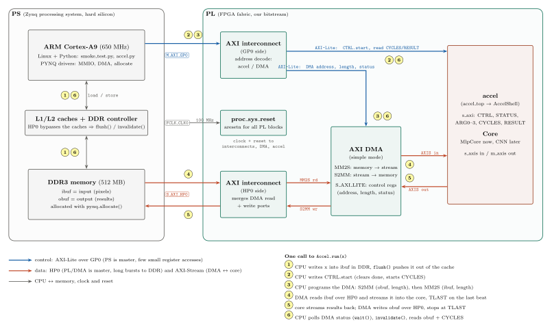

# FPGA flow (PYNQ-Z2)

```
Chisel (shell.ShellGen) ──► hw/vivado/rtl/       AccelShell.sv, accel_top.v, shell_params.tcl, hw_manifest.json
Vivado (build.tcl)      ──► hw/vivado/overlay/   accel.bit, accel.hwh, hw_manifest.json   (+ reports/)
deploy.py               ──► pynq:~/jupyter_notebooks/cnn_accel/  and runs pynq/smoke_test.py
```

`hw/vivado/` is git-ignored. Only the core inside the shell changes between the adder test and the MLP;
the block design, register map, driver and scripts stay the same.

## System view on the board



*Source: [`docs/figures/pynq_system_dataflow.tex`](../docs/figures/pynq_system_dataflow.tex). The inside of
the `accel` block is drawn in [`shell/README.md`](../generator/src/main/scala/shell/README.md).*

The PS (ARM + DDR, hard silicon) and the PL (our bitstream) talk over two kinds of AXI port:

| Port | Master | Used for | In this design |
|---|---|---|---|
| **M_AXI_GP0** (general purpose) | PS (the ARM) | Few, small register reads/writes (AXI-Lite) | ARM → `accel` registers, ARM → DMA control registers |
| **S_AXI_HP0** (high performance) | PL (the DMA) | Long bursts straight to the DDR controller, bypassing the CPU caches | DMA reads `ibuf` and writes `obuf` |

So the CPU only *controls*: it writes the input into DDR, starts the core and programs the DMA
(address + length, steps 1-3). The DMA moves the data itself over HP0 and AXI-Stream (steps 4-5), and
the CPU picks up the result when the DMA reports idle (step 6). Because HP0 bypasses the caches,
`accel.py` calls `flush()` before and `invalidate()` after each transfer.

PYNQ knows how to drive the DMA because `accel.hwh` lists it as `xilinx.com:ip:axi_dma` with its base
address, and `pynq.lib.dma.DMA` is a ready-made driver for exactly that IP. Our `accel` block has no
built-in driver, so `accel.py` maps its registers with `MMIO` and the offsets from `hw_manifest.json`.

## Prerequisites (checked 2026-10-14)

| What | Status |
|---|---|
| Vivado | 2024.1 installed in `C:\Xilinx\Vivado\2024.1`. Matches PYNQ v3.1 images (built with 2024.1). If the board runs v3.0.x (built with 2022.1), simple overlays like this one normally still load; if `Overlay()` fails parsing the `.hwh`, that mismatch is the first suspect. `smoke_test.py` prints the board's PYNQ version. |
| PYNQ-Z2 board files | Were **not** installed in Vivado. Now vendored in `hw/boards/TUL/pynq-z2` (from Xilinx/XilinxBoardStore) and loaded by `build.tcl` via `board.repoPaths`, so nothing needs installing. |
| Board on the network | Jupyter answers at `http://pynq:9090`, so SSH work as `xilinx@pynq`. |
| SSH key + sudo | One-time, see below. |

### One-time board setup (from PowerShell)

```powershell
ssh-keygen                                    # skip if you already have ~/.ssh/id_ed25519
type $env:USERPROFILE\.ssh\id_ed25519.pub | ssh xilinx@pynq "mkdir -p ~/.ssh && cat >> ~/.ssh/authorized_keys"
# Optional, lets build.tcl run the test without a password prompt:
ssh -t xilinx@pynq "echo 'xilinx ALL=(ALL) NOPASSWD: ALL' | sudo tee /etc/sudoers.d/xilinx-nopasswd"
```

## Running it

With `make` (Linux, or Windows with GNU make). The Makefile picks `vivado.bat`/`sbt.bat`/`python` on Windows
and `vivado`/`sbt`/`python3` on Linux; Vivado's `bin` folder must be on PATH. `make help` shows what it will
use; override with e.g. `make bitstream VIVADO=C:/Xilinx/Vivado/2024.1/bin/vivado.bat`.

```bash
make test        # chiseltest, incl. AXI-Lite/AXIS bus-model tests of the shell
make board       # rtl -> bitstream -> deploy -> smoke test on the board
```

Without `make` (PowerShell, from the repo root):

```powershell
cd generator; sbt "runMain shell.ShellGen --out ../hw/vivado/rtl --core stub --streamW 32"; cd ..
C:\Xilinx\Vivado\2024.1\bin\vivado.bat -mode batch -nojournal -log hw/vivado/vivado.log `
    -source hw/scripts/build.tcl -tclargs hw/vivado/rtl hw/vivado accel 8 1
```

The last argument `1` makes `build.tcl` call `deploy.py` at the end, which copies the overlay and the
driver to the board and runs `smoke_test.py`. Use `0` to only build, then
`python hw/scripts/deploy.py --overlay hw/vivado/overlay/accel.bit`.

Expected board output ends with `ALL PASSED`. The overlay and `smoke_test.py` also land in
`cnn_accel/` in Jupyter, so you can poke registers interactively with `from accel import Accel`.

## Register map (AXI-Lite, identical for every core)

| Offset | Name | Access | Meaning |
|---|---|---|---|
| 0x00 | CTRL | W | bit0 start (pulse), bit1 soft-reset core |
| 0x04 | STATUS | R | bit0 busy, bit1 done (sticky, cleared by start) |
| 0x08 | ID | R | 0xDEADBEEF (`AccelConfig.id`) |
| 0x0C | CFG_HASH | R | must equal `cfg_hash` in hw_manifest.json |
| 0x10 / 0x14 | N_IN / N_OUT | R | packet sizes |
| 0x18 | CYCLES | R | clock cycles start → done |
| 0x1C | OVF_COUNT | R | activations that saturated (core-defined) |
| 0x20 | RESULT | R | core-defined (MLP: argmax; stub: beats in last packet) |
| 0x40–0x4C | ARG0–ARG3 | RW | passed to the core as `io.args` |
| 0x50 | SUM | R | ARG0 + ARG1 (adder smoke test) |

## Adding the MLP

1. Write `class MlpCore(cfg: AccelConfig) extends AccelCore(cfg)` implementing `CoreIO`
   (consume `nIn` beats, produce `nOut` beats, **set `last` on the final output beat**).
2. Add `case "mlp" => new MlpCore(cfg)` in `AccelCore.apply` (`generator/src/main/scala/shell/Core.scala`).
3. `make board CORE=mlp STREAM_W=8` — no change to Tcl, driver or block design.