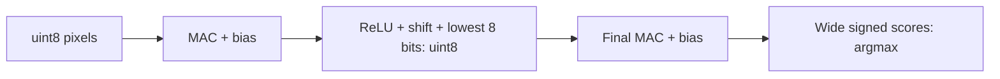

# Setup and run model

```text
python/
  scripts/       Training, integer reference and evaluation
  models/        Trained checkpoint
    csv/         Readable weight and bias exports
  results/       Accuracy reports
  tests/         Python tests
  data/          MNIST images and labels
```

Run the commands below from this directory.

# 1. Make virtual env (Python 3.10+)
`python3 -m venv venv`

# 2. activate
`source venv/bin/activate`       # Linux/macOS

`.\venv\Scripts\activate`       # Windows

Run `deactivate` to leave the venv if needed

# 3. Update pip and get req
`pip install --upgrade pip`

`pip install -r requirements.txt`

# 4. Run and train model
`python3 -m scripts.train_model`

# Quantize and evaluate

From this directory, with your Python environment activated:

```sh
cd ../generator
sbt "runMain service.WeightExporter"
cd ../python
python -m scripts.evaluate_quantized
```

`WeightLoader` quantizes weights and biases once in Scala. `WeightExporter`
saves integer CSVs + `layers.csv` in `generator/generated/quantized/`.
Repeat both commands after retraining.

# Quantization rules

- Pixels and hidden activations: uint8 (0..255); pixels map 0..1 to 0..255.
- Weights: int8, fixed scale 1/128, zero-point 0. `qw = min(round(w * 128), 127)`;
  weights outside [-1, 1] are rejected. CSV layout: `[input][output]`.
- Bias: int32 at input-scale × weight-scale. For real value per input integer
  `sx`, `qb = round(b * 128 / sx)`. Parameter rounding uses nearest, halves towards +∞.
- Hidden layers: ReLU → right shift → lowest 8 bits. Shift truncates; no saturation.
  The loader picks a shift so the worst-case positive output fits 0..255.
- `layers.csv` stores `index,multiplier,shift`: currently `(0,1,13)` and `(2,1,11)`.
  Multiplier is 1; hidden output scale is `sx * 2^shift / 128`. Final shift is unused.
- MAC widths are calculated from the number of inputs: 26/23 signed bits here.
  Export checks conservative bounds;
  the reference uses int64 temporaries and rejects MAC/int32 overflow.
- Final scores stay wide and signed, with no ReLU or shift. Argmax picks the largest;
  ties pick the lowest index.

# Integer reference



`scripts/integer_reference.py` runs NumPy integer inference. Evaluation compares
its accuracy with the float model. A separate test checks every output score
against a PyTorch integer pass on all 10,000 MNIST test images.
Layer shapes, ranges and shifts are checked when loading; inference checks MAC overflow.
Current checkpoint: float **96.61%**, quantized **96.69%** (+0.08 percentage points).
Saved in `results/quantization_results.csv`.

Tests: `python -m unittest discover -s tests -t .` (requires exported CSVs and local MNIST data).
